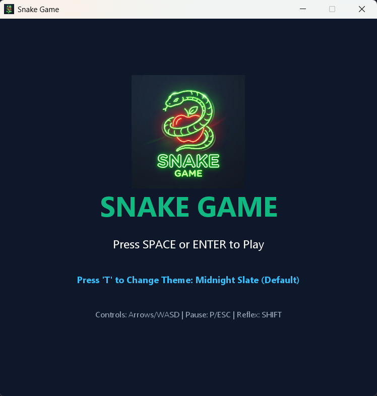
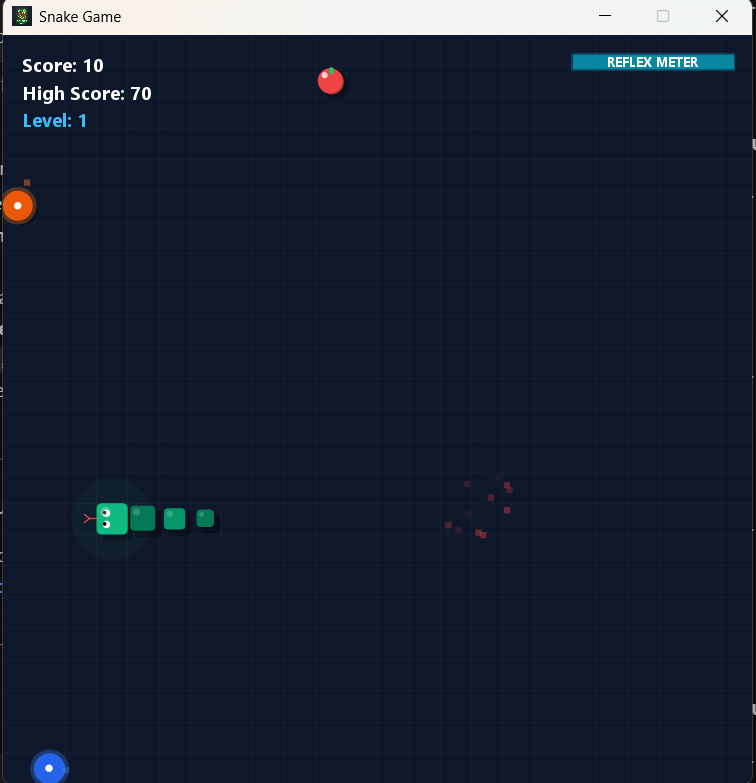

# 🐍 Snake Game - Retro Arcade Edition

A highly polished, 2D arcade Snake Game built from scratch using **Java Swing** and clean **Object-Oriented Design (OOD)** principles. 

Featuring custom 3D specular graphics, programmatic audio synthesis, dynamic level structures, slow-motion bullet time, and teleportation gates, this project elevates the classic retro concept into a modern arcade experience.

---

## 🎨 Standout Features

### 🎮 Gameplay Mechanics
- **"Bullet Time" Slow Motion**: Hold or tap `SHIFT` to slow down time to 33% speed to navigate through tight areas. Depletes a custom **Reflex Meter** HUD bar that regenerates when idle and boosts when eating apples.
- **Portal Teleportation Gates**: Swirling **Blue** and **Orange** wormholes spawn on the grid. Steering into one wormhole teleports the snake's head out of the other with automatic exit offsets to prevent loop traps.
- **Dynamic Levels & Obstacles**: 
  - **Level 1 (Score 0-40)**: Classic open grid.
  - **Level 2 (Score 50-110)**: Adds 4 metallic stone pillars in the grid corners.
  - **Level 3 (Score 120+)**: Adds a central cross structure.
- **Timed Golden Apples**: Food has a 15% chance to spawn as a glowing, pulsing Golden Apple worth 30 points. It degrades back to a normal apple if not eaten within 6 seconds (tracked by a HUD progress bar).

### ⚙️ Engine & Architecture Polish
- **Programmatic Sound Effects**: Generates and plays 8-bit retro sound sweeps (eating, level-up, game over, clicks) dynamically using Java's standard `javax.sound.sampled` library—**no external audio assets required**.
- **Input Queue Buffer**: Keyboard steering is buffered into a FIFO queue (size 2). Resolves rapid double-keystroke inputs that usually cause self-deaths in standard snake grid engines.
- **EDT Thread Safety**: UI initialization is bound thread-safely on the Event Dispatch Thread (EDT). All persistent disk operations (High Score loading/saving) run asynchronously on background threads using `CompletableFuture`.
- **Package-Ready Resource Streaming**: Assets (like the logo) are loaded via resource input streams supporting compiler JAR packing out-of-the-box.

### 🖼️ Realistic 3D Aesthetics
- **Dropshadows**: All segments, portals, apples, and stone pillars cast soft transparent black dropshadows onto the grid guides below them.
- **3D Specular Shading**: Apples and snake body parts feature glassmorphic specular glare dots, creating a shiny spherical visual structure.
- **Tapered Snake Body**: Snake segments gradually narrow towards the tail tip for an organic, creature-like shape.
- **Ambient Lighting**: Glowing radial lighting halos illuminate the ground around the snake's head and Golden Apples.

---

## 📸 Screenshots

| Start Screen | Gameplay |
| :---: | :---: |
|  |  |

---

## 🎮 Controls

| Key | Action |
|---|---|
| **Arrow Keys** or **WASD** | Steering (Up, Down, Left, Right) |
| **Shift** | Toggle "Bullet Time" (Slow Motion) |
| **P** or **ESC** | Pause / Resume |
| **Space** or **Enter** | Start Game / Restart (on Game Over) |
| **T** *(Start Screen only)* | Cycle Color Themes |

### Available Themes:
1. **Midnight Slate** *(Default)*: Slate-900 background, emerald green snake, ruby red apple.
2. **Cyberpunk Neon**: Deep violet background, electric cyan snake, hot rose pink food.
3. **Matrix Console**: Pitch black background, glowing neon green snake, green terminal HUD.

---

## 🛠️ Project Structure

```
SnakeGame/
├── .idea/                 # IntelliJ IDEA configuration files
├── .gitignore             # Git exclusion rules
├── logo.png               # Custom retro-neon logo asset
├── screenshot_start.png   # Start Screen screenshot
├── screenshot_gameplay.png# Gameplay Screen screenshot
├── SnakeGame.iml          # IntelliJ module descriptor
├── Main.java              # EDT Entry point launcher
├── GameFrame.java         # Frame window container (JFrame)
├── GamePanel.java         # Controller, Timer loop, and HUD view
├── Snake.java             # Snake segment coordinate history & shadows
├── Food.java              # Normal & Golden apples, spawn validation
├── Direction.java         # Navigation direction enum
├── GameTheme.java         # Styling theme configuration enum
├── SoundPlayer.java       # Background chiptune frequency generator
├── HighScoreManager.java  # Async local I/O persistence
└── Particle.java          # Spark burst explosion animation
```

---

## 🚀 Installation & Local Execution

### Prerequisites
- **Java Development Kit (JDK)**: JDK 8 or higher (Tested up to JDK 26).

### Running from Command Line
1. Clone the repository:
   ```bash
   git clone https://github.com/daystar-1nine/SnakeGame.git
   cd SnakeGame
   ```
2. Compile the Java files:
   ```bash
   javac *.java
   ```
3. Run the application:
   ```bash
   java Main
   ```

### Running in IntelliJ IDEA
1. Open IntelliJ IDEA.
2. Go to **File > Open** and select the `SnakeGame` directory.
3. The IDE will automatically detect the `.iml` and `.idea` files.
4. Click the **Run** button in the top right toolbar to execute the pre-configured `Main` run configuration.
